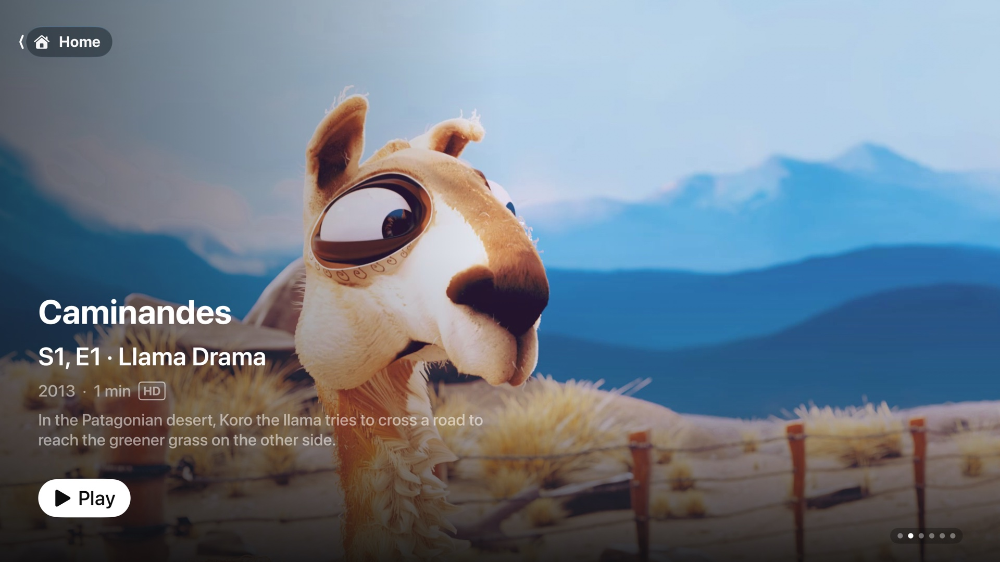
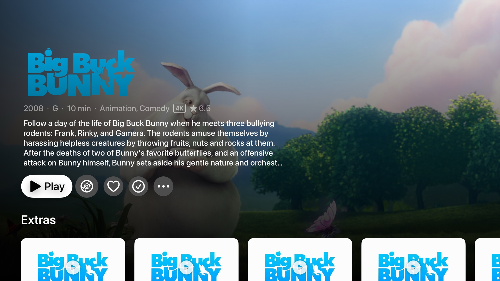
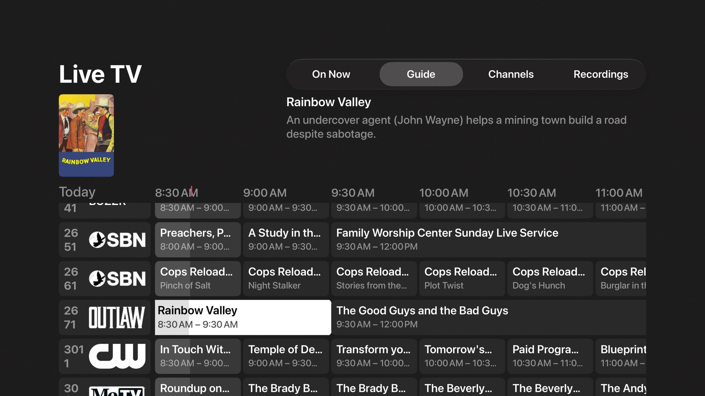
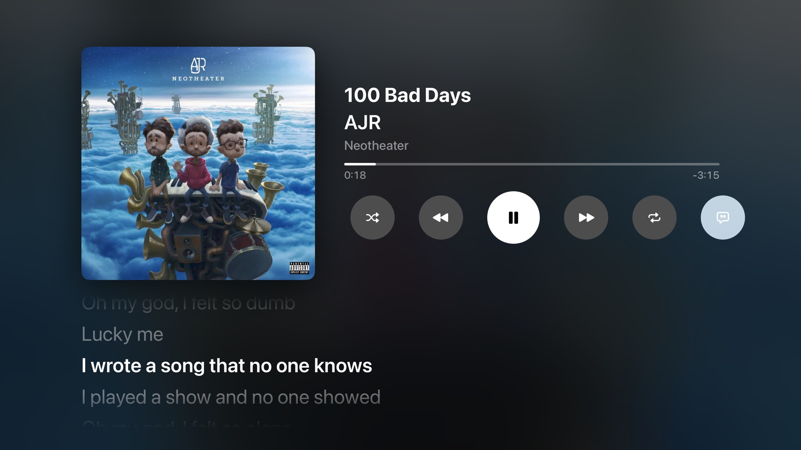
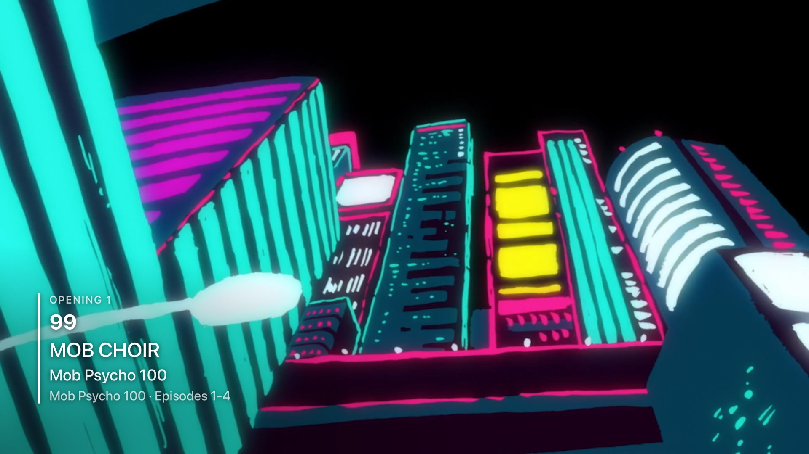
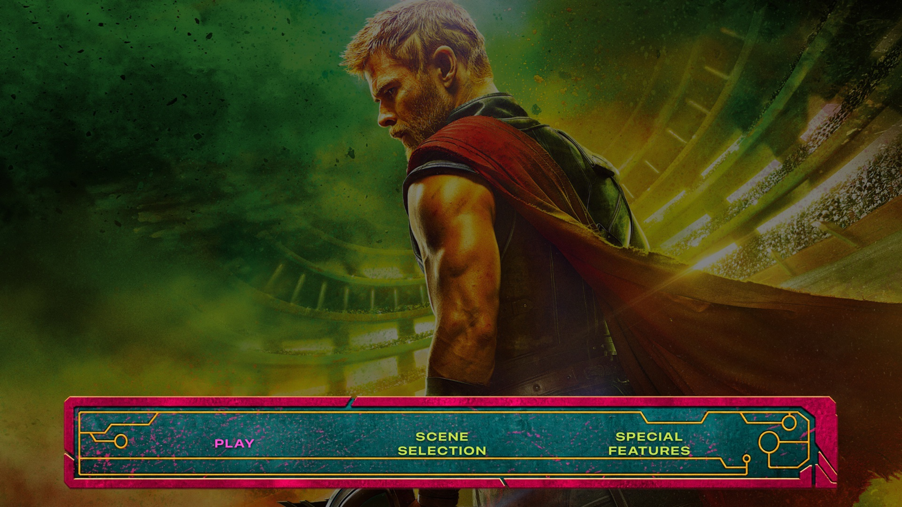
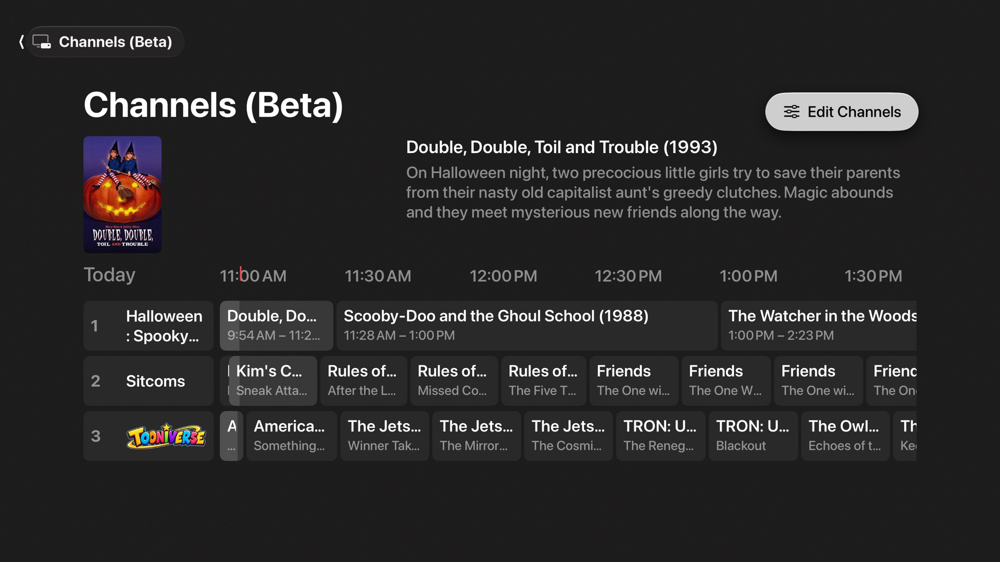

<p align="center">
  
</p>

# Aster Media Player

A native Jellyfin client for Apple TV, iPhone, iPad and the Mac, written in SwiftUI.

Aster covers movies, TV, anime, music, audiobooks and live TV, and can turn your Jellyfin playlists into TV-style channels. Title pages are laid out like the Apple TV app, with theme music and theme videos, and it plays JellyDisc DVD/Blu-ray-style disc menus. Videos play in **AetherEngine**, a player that plays the original file and switches every audio and subtitle track on the device, with Apple's own player as a fallback.

> Aster is in beta (0.5). Expect rough edges, and please report what you find.

## Get Aster

Aster Media Player (formerly AsterFIN) is open source, and there are three ways to get it:

- **App Store** (coming soon): one purchase covers Apple TV, iPhone, iPad and the Mac. It installs in one click, updates automatically and supports development. The beta is on TestFlight now.
- **Free IPA**: download it from [Releases](https://github.com/AsterFIN-app/AsterFIN/releases) when one is posted. Apple TV, iPhone and iPad only run signed apps, so you need to re-sign the IPA with your own Apple ID before installing it. With a free Apple ID the signature expires after 7 days; with a paid Apple Developer account it lasts a year.
- **Build it yourself**: see [Building](#building) below.

All three are the same app with the same features.

## Screenshots

Taken on Apple TV.

| | |
| --- | --- |
|  |  |
| **Home**: featured banner, Continue Watching, Up Next, recently added | **Title page**: full-bleed art, episodes, cast, Watch OP / Watch ED for anime |
|  |  |
| **Live TV**: guide, recordings, mini player | **Music**: albums, artists, lyrics, Now Playing |
|  |  |
| **Anime**: openings and endings with song cards | **Disc menus**: JellyDisc menus with transitions and sounds |
|  | |
| **Channels (Beta)**: playlists as TV channels, movies and shows in the same guide | |

## Platforms

| | Apple TV | iPhone & iPad | Mac |
| --- | :---: | :---: | :---: |
| Browsing, title pages, search | ✓ | ✓ | ✓ |
| AetherEngine player (the default) | ✓ | ✓ | ✓ |
| System player (fallback, or by choice) | ✓ | ✓ | ✓ |
| Music and audiobooks, with a now-playing bar | ✓ | ✓ | ✓ |
| Live TV | ✓ | ✓ | ✓ |
| Channels from playlists (beta) | ✓ | ✓ | ✓ |
| Downloads for offline viewing | | ✓ | |
| Top Shelf | ✓ | | |
| Full-screen playback, keyboard shortcuts | | | ✓ |
| CarPlay audiobooks | | waiting on Apple's entitlement | |

## Features

### Watching
- **Home**: a featured banner, then shelves for Continue Watching, Up Next, recently added Movies, TV Shows and Anime, and one shelf per library. Play or Resume on the banner starts the title straight away, and Back lands on its page.
- **Title pages**: theme music and muted looping theme videos fade in and out. Each page has seasons and episodes, cast, and related titles. On an episode, a bar under Play lists the rest of the season.
- **Upcoming**: episodes airing soon from the shows in your library, day by day, with a banner of what's next.
- **Up Next**: at the end of an episode an Up Next card counts down to the next one. Skip Intro, Skip Credits and Play Next Episode come from the server's media segments. Intros can also be skipped automatically.
- **Playlists**: Add to Playlist from any title. Video playlists have Play All and Shuffle, and you can reorder or remove items.

### Two players
- **AetherEngine** (the default): plays the original file through [AetherEngine](https://github.com/superuser404notfound/AetherEngine) (FFmpeg demuxing, VideoToolbox decoding), so nothing is transcoded unless it has to be.
  - **Tracks:** every audio and subtitle track switches on the device instantly, PGS/DVB/VobSub picture subtitles are drawn as they are, and HDR10, Dolby Vision and Atmos pass through.
  - **When the file is too much:** AV1 and VP9 on Apple TV, which has no hardware for them, are converted by the server and still play in AetherEngine. So does a lower quality, picked from the Quality menu or from the card that comes up when playback keeps stalling.
  - **When it can't play something:** the title moves to the system player by itself, from the same spot and on the same tracks.
  - **Apple TV controls:** they work like the system player's. Click to pause, swipe to scrub while paused (with a preview frame), swipe down for Chapters, Audio, Subtitles and Quality, and Back steps out one level at a time.
  - **iPhone and iPad controls:** double-tap either side to skip 10 seconds, pinch to fill the screen, a scrub preview, and menus for chapters, speed (0.5x to 2x), audio, subtitles and quality, plus AirPlay.
  - **Scrub previews:** Jellyfin's trickplay images when the server has made them, else stills from what's already downloaded.
  - **Now Playing:** the lock screen, Control Center and headphone buttons on iPhone and iPad, and the Mac's Now Playing.
  - **Pause screen:** on Apple TV and the Mac, the title's logo and details appear, with a long description scrolling slowly.
- **System player** (Settings ▸ Playback ▸ "Use the system player"): Apple's player. Aster direct plays when it can and asks the server to transcode when it can't. If a stream fails, it retries with a fresh H.264/AAC encode. Playlists (Play All, Shuffle), downloads and opening/ending clips always use it.

### Subtitles
- **Text subtitles:** Aster draws them itself from Jellyfin's cue data, so they work in direct play as well as HLS.
- **ASS/SSA:** drawn with [libass](https://github.com/libass/libass) as the release intended: signs where they belong, vector drawings, blur and clips, in the fonts embedded in the file. You can turn this off for plain text in Settings ▸ Audio & Subtitles.

### Anime
- **Anime tab:** libraries matched by Shoko/AniDB get their own tab and are left out of Movies and TV Shows. The tab has its own banner and appears only when the server has anime.
- **Openings and endings:** they come from the OP/ED plugin, or from chapter markers if it isn't installed. While one plays, a "music video" card shows the song, artists and series.

### Music and audiobooks
- **Music:** albums, artists, playlists and songs. The full player has shuffle, repeat and lyrics, plus system Now Playing info.
- **Audiobooks:** books are put together from a library's files, with authors and series taken from the folders. There are chapters, per-book playback speed, and progress synced with Jellyfin. On iPhone and iPad you can download a book and listen offline, and Listen Ahead (Settings ▸ Playback; 30 minutes by default) keeps the next stretch of a streamed book on the device so it plays on through a spot with no signal.
- **Back to the player from anywhere:**
  - on iPhone and iPad, a bar under the tab bar;
  - on the Mac, a bar at the foot of the sidebar and the Space bar;
  - on Apple TV, the remote's Play/Pause button.
- **Background audio:** both keep playing in the background.

### Live TV
- What's on now, a programme guide, a channel list and recordings.
- Channels play through AetherEngine. A mini player keeps the channel playing in the header after you press Back, and choosing another channel switches it in the same player.
- Record single programmes, or set series recording rules with options.

### Channels (Beta)
Your Jellyfin video playlists become TV-style channels on a Channels tab, laid out in the same guide as Live TV. Tune in and you join whatever is on, partway through, and when it ends the channel carries on to what's on next.
- **Set up in Jellyfin:** a playlist becomes a channel through its tags, so your server is the one place channels live and every device finds the same ones. Tag a playlist in Jellyfin's web interface (the playlist's Edit Metadata ▸ Tags), or use **Edit Channels** on the Channels tab or in Settings ▸ Channels (Beta), which writes the same tags. Only a server administrator can change them; everyone else sees the channels read-only. The Channels tab appears once a playlist is tagged.

  | Tag | Meaning | Default |
  | --- | --- | --- |
  | `aster:channel` | This playlist is a channel | not a channel |
  | `aster:number=101` | Its channel number | numbered after the rest, by name |
  | `aster:mode=blocks` | `rotation`, `blocks`, `shuffle`, `sequential` or `airdate` (everything in the order it first aired) | `rotation` |
  | `aster:logo=on` | The playlist's picture is the channel's logo | off (the name is shown) |
  | `aster:reshuffle=week` | How long one order of shows lasts: `day`, `week` (Monday to Monday) or `month` | `day` |
  | `aster:seed=2` | Deals a fresh lineup; any other number deals another | the channel's original lineup |
  | `aster:blocks=3-6` | How many episodes play in a row in Blocks mode | 2 to 4 |
  | `aster:bug=on` | The logo, faint in the corner while the channel plays | off |
  | `aster:bug-location=top-left` | The bug's corner: `top-left`, `top-right`, `bottom-left` or `bottom-right` | `bottom-right` |
  | `aster:bug-size=150%` | The bug's size, 25% to 300% of the usual | `100%` |
  | `aster:bug-hide=30` | Seconds the bug shows after tuning in or a programme starting, then fades | `off` (always shown) |
  | `aster:bug-opacity=60%` | How solid the bug is, 5% to 100% | `45%` |
  | `aster:genre=Horror` | Also plays every movie and episode in this genre; repeat the tag for more genres (any of them) | none |
  | `aster:network=NBC` | Also plays every movie and episode from this studio or network; repeat for more | none |
  | `aster:collection=Star Wars Collection` | Also plays everything in this collection; repeat for more | none |
  | `aster:type=movies` | With genres, networks or collections: `all`, `movies` or `shows` | `all` |
  | `aster:years=1980-1989` | With genres, networks or collections: only titles from these years (or one year, `1994`) | any year |
  | `aster:rating=TV-PG,PG` | With genres, networks or collections: only titles with these content ratings | any rating |
  | `aster:library=TV Shows` | With genres or networks: only from this library; repeat for more | every library |
  | `aster:weight=Friends:2` | This show takes two turns (up to 5) to every other show's one; repeat for more shows | 1 each |
  | `aster:min-length=20` | Leaves out anything shorter, in minutes | none |
  | `aster:max-length=60` | Leaves out anything longer, in minutes | none |
  | `aster:filler-playlists=Hazbin Bumpers` | A filler playlist (one tagged `aster:filler`) for its breaks between programmes; repeat for more. Each clip's own tag says what it is | none |
  | `aster:filler-types=commercials,bumpers` | With filler: which kinds of clip to play: `bumpers`, `promos`, `commercials`, `trailers`, `interstitials`, or `all` | `all` |
  | `aster:bumpers-at=out` | With breaks: a bumper `both` before and after each break, only before it (`out`), or only after (`in`) | `both` |
  | `aster:break-length=4` | With breaks: minutes of commercials in each break, 0 to 30 | `2` |
  | `aster:promo-count=2` | With breaks: promos in each break, 0 to 5 | `1` |
  | `aster:trailer-count=2` | With breaks: trailers in each break, 0 to 5 | `1` |
  | `aster:interstitial-count=2` | With breaks, not lined up: interstitials in each break, 0 to 5 | `1` |
  | `aster:break-every=2` | With breaks, not lined up: a break after every programme, or every 2nd to 10th | `1` |
  | `aster:align-fit=exact` | Lined up: `best` fills each gap with whole clips of every kind the channel has, as near the mark as they get without passing it (a programme can start a few seconds early); `exact` fills with interstitials and cuts the last one short to land on it | `best` |
  | `aster:align=30` | With breaks: every programme starts on the half hour (or every 5, 10, 15, 20 or 60 minutes), its break running on to the mark | `off` |
  | `aster:user=peppy,jd` | Only these users (by Jellyfin user name) get the channel in Aster; repeat for more. It doesn't hide the playlist in Jellyfin | everyone |
  | `aster:channel-name=Late Night` | The channel's name, in place of the playlist's | the playlist's name |

  Turning a playlist on in Aster writes every tag, defaults included (all but the name), so each one is there to change in Jellyfin; turning it off writes `aster:channel=off` and keeps the rest. Case doesn't matter, other tags are left alone, and a value Aster doesn't understand falls back to the default. Tags written before the app was renamed (`asterfin:…`) still work, and are rewritten as `aster:…` the first time an administrator signs in.
- **Breaks:** add bumpers, promos, commercials, trailers and interstitials to Jellyfin as ordinary videos and tag each with what it is: `aster:commercial`, `aster:promo`, `aster:trailer`, `aster:interstitial` or `aster:bumper`. A bumper tagged `aster:bumper=in` only closes a break, right before the programme (a countdown), and `aster:bumper=out` only opens one; a clip without a tag isn't played. Put them in playlists, any mix, tagged `aster:filler`, and name those on a channel with `aster:filler-playlists=` (or pick them in Edit Channels, which offers only filler playlists), so one playlist of commercials can serve many channels. Each break plays a bumper, its commercials, its promos, its trailers, its interstitials, and a bumper back. With `aster:align=30`, programmes line up on the hour and half hour: by default each break is filled with whole commercials, promos, trailers, interstitials and bumpers, as near the mark as they get without passing it, so a programme may start a few seconds early; with `aster:align-fit=exact`, interstitials fill to the mark and the last is cut short to land right on it. Breaks are the same on every device, and the guide folds each one into the programme before it.
- **Genre, network and collection channels:** New Channel in Edit Channels makes a channel that fills itself from genres (Horror, Comedy, …), networks (NBC, Cartoon Network, …) and collections, narrowed to movies or shows, years, content ratings and libraries if you like, along with anything added to its playlist by hand. A show brings every one of its episodes. It's shared with everyone on the server.
- **Movies and TV:** a series plays its episodes in order and picks up where it left off, like reruns. Specials are left out, and each movie takes a turn of its own.
- **Four modes, chosen per channel:** **Rotation** plays one episode of each show in turn; **Blocks** plays a few in a row (two to four unless `blocks=` says otherwise); **Shuffle** mixes every episode and movie on its own. These three are reshuffled every day, or every week or month with `reshuffle=`, and **Shuffle Again** in Edit Channels deals a fresh lineup. **In Order** (`sequential`) plays the playlist exactly as it's arranged, over and over.
- **A week ahead:** the guide covers the next 7 days, with a day picker at the top.
- **Same guide everywhere, without a server:** each channel's schedule is worked out on the device from the playlist and the clock, so every device shows the same programme at the same moment. Nothing is stored and no plugin is needed.
- **Watch history is left alone:** watching a channel doesn't change resume points, watched marks or Continue Watching.

### Disc menus
- Aster renders DVD/Blu-ray-style menus from the **JellyDisc** plugin. They support backgrounds, chapter and trailer screens, and theme songs.
- Screens change with fade, slide, rise, zoom or wipe transitions. Menu music and click, chime or beep sounds are built in, or a menu can ship its own sound files.
- Conformance tests check the menu rules against the plugin's published test vectors.

### Platform integration
- **Apple TV:** a Top Shelf showing Continue Watching, Next Up and recent Live TV channels, and the native search tab.
- **iPhone and iPad:**
  - Downloads, in the background, with your choice of quality, storage limit and cellular use. Progress made offline syncs back to the server.
  - A tab bar you can reorder.
- **Mac:**
  - A sidebar and a Settings window (⌘,).
  - Videos play full screen (or in the window, if you'd rather).
  - Keyboard shortcuts: Space to play or pause, ← → to jump, Esc to close.
- **Deep links:** `aster://item/{id}` opens a title page, and `aster://play/{id}` starts playback.
- **Sign-in:** password or Quick Connect, with multiple users per server.
- **Settings that follow you:** Up Next, skipping intros, styled subtitles, disc menus, theme music and videos, and song cards are kept on your Jellyfin server (in Aster's display preferences), so they match on every device you sign in on. Audio and subtitle languages use your Jellyfin user settings. Streaming quality, the system player switch, the tab bar and downloads stay per device.

## Server requirements

Aster works with a recent Jellyfin server (10.10 or later recommended). All plugins are optional, and features that depend on them turn on when they're present:

| Plugin | Enables |
| --- | --- |
| JellyDisc | Disc menus |
| Intro Skipper (or chapters / EDL) | Skip Intro and Skip Credits |
| OP/ED | Anime openings and endings with song details |
| Shoko | Detecting Anime libraries |

Theme songs and theme videos use Jellyfin's standard theme media.

## Building

Requirements:
- Xcode 27
- The tvOS 27, iOS 27 and macOS 27 SDKs (every platform's deployment target is 27.0)
- An Apple silicon Mac. AetherEngine's decoders ship for arm64 only, so the simulators run as arm64.

```sh
git clone https://github.com/AsterFIN-app/AsterFIN.git
open AsterFIN/AsterFIN.xcodeproj
```

Xcode fetches the Swift packages on first open. Select the **AsterFIN** scheme (the project keeps its earlier name for now) and an Apple TV, iPhone, iPad or Mac destination, then build and run.

To run on a device, set your own development team in **Signing & Capabilities** for both the `AsterFIN` and `AsterFINTopShelf` targets. Top Shelf needs an App Group that both targets share (`group.app.asterfin` by default), so change it to one your team owns.

### Project layout

| Folder | Contents |
| --- | --- |
| `AsterFIN/App` | Session state, settings, deep link routing |
| `AsterFIN/Jellyfin` | API client, models, Keychain storage |
| `AsterFIN/Player` | Both video players, subtitles (text and libass), music, audiobook and theme players |
| `AsterFIN/DiscMenu` | JellyDisc menu models, rules, rendering, transitions, audio |
| `AsterFIN/Downloads` | Video and audiobook downloads (iPhone and iPad) |
| `AsterFIN/CarPlay` | CarPlay scene (needs Apple's entitlement) |
| `AsterFIN/UI` | Feature screens (Home, Library, Detail, Upcoming, Live TV, Channels, Music, Audiobooks, Anime, …) |
| `AsterFINTopShelf` | Top Shelf extension |
| `AsterFINTests` | Unit tests and JellyDisc conformance vectors |

## Known limitations

- **System player:**
  - Picture-based subtitles (PGS, VobSub) are burned in by the server, which forces a transcode.
  - A transcoded stream has one audio track, so switching audio needs direct play.
  - Use AetherEngine for both.
- **Jellyfin HLS subtitles:** Jellyfin's fMP4 HLS output times subtitles about 10 seconds late (jellyfin/jellyfin#16647). Aster avoids this by drawing subtitles itself.
- **AetherEngine:**
  - No Picture in Picture yet.
  - A converted stream (AV1 on Apple TV, or a lower quality) carries one audio track, so switching audio asks the server for a new stream.
  - Video the engine decodes in software has no system Now Playing info.
  - The Apple TV's Control Center doesn't list Aster's video, with either player.
- **Channels (beta):**
  - Each day starts at local midnight, so devices in different time zones show different schedules.
  - Editing a playlist changes that channel's schedule from then on, including how far each show has got.
  - There's no channel up/down inside the player yet.
- **Mac:** the Mac app has no downloads yet.
- **Anime without the OP/ED plugin:** openings and endings are guessed from chapter names.

## Open-source components

| Component | License |
| --- | --- |
| [AetherEngine](https://github.com/superuser404notfound/AetherEngine) | LGPL-3.0, with an exception for App Store distribution |
| ↳ [FFmpeg](https://ffmpeg.org) (via FFmpegBuild, as separate frameworks) | LGPL-2.1 |
| ↳ libdovi, the TrueHD decoder | MIT |
| ↳ the DTS:X decoder | Apache-2.0 |
| ↳ SMBClient | MIT |
| [swift-ass-renderer](https://github.com/mihai8804858/swift-ass-renderer) and swift-libass ([libass](https://github.com/libass/libass)) | MIT (libass: ISC) |
| Point-Free's swift-issue-reporting, swift-concurrency-extras, combine-schedulers | MIT |

## License

Aster is licensed under the [Mozilla Public License 2.0](LICENSE). You're free to use, modify and redistribute it. If you distribute a modified version, the files of Aster you changed must stay available under the MPL. New files you add can use any license. The components above keep their own licenses.

The Aster name and app icon aren't covered by the license. If you publish your own build, for example on the App Store, give it a different name and icon so people don't confuse it with the official app.

Aster isn't affiliated with or endorsed by the Jellyfin project.
