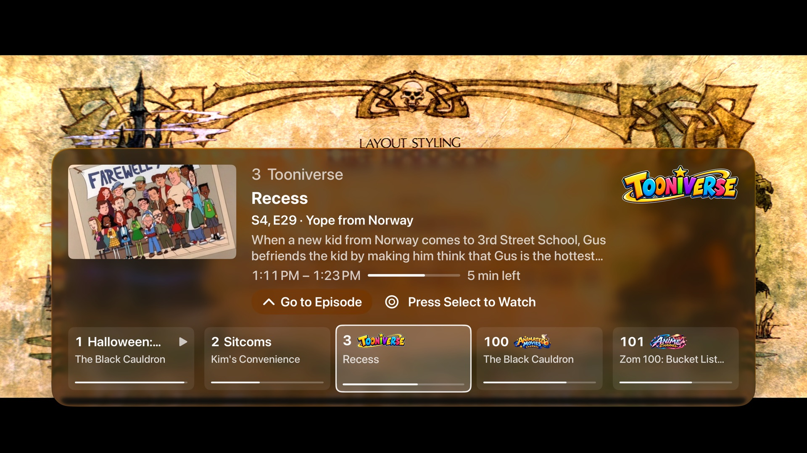

<p align="center">
  
</p>

# Aster Media Player

A native client for Jellyfin, Emby and Plex on Apple TV, iPhone, iPad and the Mac, written in SwiftUI.

Aster covers movies, TV, anime, music, audiobooks and live TV, and can turn your Jellyfin playlists into TV-style channels. Emby and Plex servers work too: see [Servers](#servers) for what each one gets. Title pages are laid out like the Apple TV app, with theme music and theme videos, and it plays JellyDisc DVD/Blu-ray-style disc menus. Videos play in **AetherEngine**, a player that plays the original file and switches every audio and subtitle track on the device, with Apple's own player as a fallback.

> Aster is in beta (0.10). Expect rough edges, and please report what you find.

## Get Aster

Aster Media Player (formerly AsterFIN) is free, and always will be: on every platform, with every feature, and no paid version. It's open source, and there are three ways to get it:

- **App Store** (coming soon): free, with one download for Apple TV, iPhone, iPad and the Mac. It installs in one click and updates automatically. The beta is on TestFlight now.
- **IPA**: download it from [Releases](https://github.com/AsterMediaPlayer/Aster-Media-Player/releases) when one is posted. Apple TV, iPhone and iPad only run signed apps, so you need to re-sign the IPA with your own Apple ID before installing it. With a free Apple ID the signature expires after 7 days; with a paid Apple Developer account it lasts a year.
- **Build it yourself**: see [Building](#building) below.

All three are the same app with the same features.

## Screenshots

Taken on Apple TV, with openly licensed films from the Blender Foundation and friends.

| | |
| --- | --- |
|  |  |
| **Home**: featured banner, Continue Watching, Up Next, recently added | **Title page**: full-bleed art, extras, cast, related titles |
|  |  |
| **Music**: albums, artists, lyrics, Now Playing | **Disc menus**: menus from the Aster Disc plugin, with transitions and sounds |
|  |  |
| **Channels (Beta)**: playlists as TV channels, movies and shows in the same guide | **Channel row**: press Up while watching to flick through channels, or Go to Episode |

## Platforms

| | Apple TV | iPhone & iPad | Mac |
| --- | :---: | :---: | :---: |
| Browsing, title pages, search | ✓ | ✓ | ✓ |
| AetherEngine player (the default) | ✓ | ✓ | ✓ |
| System player (fallback, or by choice) | ✓ | ✓ | ✓ |
| Music and audiobooks, with a now-playing bar | ✓ | ✓ | ✓ |
| Live TV | ✓ | ✓ | ✓ |
| Channels from playlists (beta) | ✓ | ✓ | ✓ |
| Downloads for offline viewing | | ✓ | |
| Top Shelf | ✓ | | |
| Full-screen playback, keyboard shortcuts | | | ✓ |
| CarPlay audiobooks | | waiting on Apple's entitlement | |

## Features

### Watching
- **Home**: a featured banner, then shelves for Continue Watching, Up Next, recently added Movies, TV Shows and Anime, and one shelf per library. Play or Resume on the banner starts the title straight away, and Back lands on its page.
- **Title pages**: theme music and muted looping theme videos fade in and out. Each page has seasons and episodes, cast, and related titles. On an episode, a bar under Play lists the rest of the season.
- **Upcoming**: episodes airing soon from the shows in your library, day by day, with a banner of what's next.
- **Up Next**: at the end of an episode an Up Next card counts down to the next one. Skip Intro, Skip Credits and Play Next Episode come from the server's media segments. Intros can also be skipped automatically.
- **Playlists**: Add to Playlist from any title. Video playlists have Play All and Shuffle, and you can reorder or remove items.

### Two players
- **AetherEngine** (the default): plays the original file through [AetherEngine](https://github.com/superuser404notfound/AetherEngine) (FFmpeg demuxing, VideoToolbox decoding), so nothing is transcoded unless it has to be.
  - **Tracks:** every audio and subtitle track switches on the device instantly, PGS/DVB/VobSub picture subtitles are drawn as they are, and HDR10, Dolby Vision and Atmos pass through.
  - **When the file is too much:** AV1 and VP9 on Apple TV, which has no hardware for them, are converted by the server and still play in AetherEngine. So does a lower quality, picked from the Quality menu or from the card that comes up when playback keeps stalling.
  - **When it can't play something:** the title moves to the system player by itself, from the same spot and on the same tracks.
  - **Apple TV controls:** they work like the system player's. Click to pause, swipe to scrub while paused (with a preview frame), swipe down for Chapters, Audio, Subtitles and Quality, and Back steps out one level at a time.
  - **iPhone and iPad controls:** double-tap either side to skip 10 seconds, pinch to fill the screen, a scrub preview, and menus for chapters, speed (0.5x to 2x), audio, subtitles and quality, plus AirPlay.
  - **Scrub previews:** Jellyfin's trickplay images when the server has made them, else stills from what's already downloaded.
  - **Now Playing:** the lock screen, Control Center and headphone buttons on iPhone and iPad, and the Mac's Now Playing.
  - **Pause screen:** on Apple TV and the Mac, the title's logo and details appear, with a long description scrolling slowly.
- **System player** (Settings ▸ Playback ▸ "Use the system player"): Apple's player. Aster direct plays when it can and asks the server to transcode when it can't. If a stream fails, it retries with a fresh H.264/AAC encode. Playlists (Play All, Shuffle), downloads and opening/ending clips always use it.

### Subtitles
- **Text subtitles:** Aster draws them itself from Jellyfin's cue data, so they work in direct play as well as HLS.
- **ASS/SSA:** drawn with [libass](https://github.com/libass/libass) as the release intended: signs where they belong, vector drawings, blur and clips, in the fonts embedded in the file. You can turn this off for plain text in Settings ▸ Audio & Subtitles.

### Anime
- **Anime tab:** libraries matched by Shoko/AniDB get their own tab and are left out of Movies and TV Shows. The tab has its own banner and appears only when the server has anime.
- **Openings and endings:** they come from the OP/ED plugin, or from chapter markers if it isn't installed. While one plays, a "music video" card shows the song, artists and series. Without the plugin (and on Emby and Plex), the song and artists come from [AnimeThemes](https://animethemes.moe). The card moves up out of the way while the player's controls are on screen.

### Music and audiobooks
- **Music:** albums, artists, playlists and songs. The full player has shuffle, repeat and lyrics, plus system Now Playing info.
- **Audiobooks:** books are put together from a library's files, with authors and series taken from the folders. There are chapters, per-book playback speed, and progress synced with Jellyfin. On iPhone and iPad you can download a book and listen offline, and Listen Ahead (Settings ▸ Playback; 30 minutes by default) keeps the next stretch of a streamed book on the device so it plays on through a spot with no signal.
- **Back to the player from anywhere:**
  - on iPhone and iPad, a bar under the tab bar;
  - on the Mac, a bar at the foot of the sidebar and the Space bar;
  - on Apple TV, the remote's Play/Pause button.
- **Background audio:** both keep playing in the background.

### Live TV
- What's on now, a programme guide, a channel list and recordings.
- Channels play through AetherEngine. A mini player keeps the channel playing in the header after you press Back, and choosing another channel switches it in the same player.
- Record single programmes, or set series recording rules with options.

### Channels (Beta)
Channels turn your own movies and shows into TV you can just put on. Each channel runs around the clock on a schedule, with a guide like Live TV's. Tune in and you join whatever's on, partway through, then it carries on to the next thing, the way real TV does. Every device shows the same thing at the same moment.

**Make your first channel** (you need to be a server administrator):
1. Open the **Channels** tab and choose **Edit Channels**. (If you don't have the tab yet, it's in **Settings ▸ Channels (Beta)**.)
2. Under **New Channel**, pick **From a Show**, then a show.
3. That's it: the channel is playing. Go back to the Channels tab, choose it in the guide and press Select to tune in.

You can also make a channel **from a genre** (all your horror, say), **a network** (everything from NBC), **a collection**, or **one of your playlists**. Want a mix, like two shows on one channel? Make a playlist with both in Jellyfin, then pick **From One of Your Playlists**.

**Change a channel:** in Edit Channels, open a channel to see the basics: its name, number, what it plays, how it plays (**Mode**), its logo, and breaks. Everything else is under **Advanced**. On Apple TV you can also move left onto a channel in the guide and press Select to open its settings.

**Add commercial breaks** (optional):
1. Add your clips to Jellyfin as ordinary videos: commercials, trailers, promos, short filler videos ("interstitials"), and bumpers (the channel's own "We'll be right back" clips).
2. In Jellyfin, tag each clip with what it is: `aster:commercial`, `aster:trailer`, `aster:promo`, `aster:interstitial` or `aster:bumper`. A clip without one of these tags is skipped.
3. Put them in a playlist, any mix, and tag the playlist `aster:filler`.
4. In Edit Channels, pick that playlist under **Breaks**.

Now there's a break after each programme, and the channel lines itself up so shows start on the hour and half hour. One playlist of breaks can serve as many channels as you like.

**How a channel picks what to play:**
- **Rotation** (the usual): one episode of each show in turn, like a channel of reruns.
- **Blocks:** two to four episodes of a show in a row, then the next show.
- **Shuffle:** everything in a random order.
- **In Order:** the playlist exactly as you arranged it, round and round.
- **Air Date:** everything in the order it first aired.

Shows always play their episodes in order and pick up where they left off. Specials are left out.

**Good to know:**
- **Your watch history is safe:** watching a channel doesn't change resume points, watched marks or Continue Watching.
- **Want to watch something properly?** On Apple TV, press Up for the channel row, then Up again to **Go to Episode**. It plays the episode on its own, from where you left off, with skipping, scrubbing and Up Next. On a channel itself you can pause but not skip, so everyone stays on the same schedule.
- **Who sees a channel:** everyone on your server, as long as its playlist is shared with them or public. To keep a channel to certain people, pick them under **Advanced ▸ Users**.
- **The guide covers a week ahead,** with a day picker at the top.
- **Your channels live on your server:** every setting is saved as a tag on the playlist in Jellyfin, so every device finds the same channels, and you can edit the tags in Jellyfin too. The full list is in [docs/channel-tags.md](docs/channel-tags.md).

### Disc menus
- Aster renders DVD/Blu-ray-style menus from the **JellyDisc** plugin. They support backgrounds, chapter and trailer screens, and theme songs.
- Screens change with fade, slide, rise, zoom or wipe transitions. Menu music and click, chime or beep sounds are built in, or a menu can ship its own sound files.
- Conformance tests check the menu rules against the plugin's published test vectors.

### Platform integration
- **Apple TV:** a Top Shelf showing Continue Watching, Next Up and recent Live TV channels, and the native search tab.
- **iPhone and iPad:**
  - Downloads, in the background, with your choice of quality, storage limit and cellular use. Progress made offline syncs back to the server.
  - A tab bar you can reorder.
- **Mac:**
  - A sidebar and a Settings window (⌘,).
  - Videos play full screen (or in the window, if you'd rather).
  - Keyboard shortcuts: Space to play or pause, ← → to jump, Esc to close.
- **Deep links:** `aster://item/{id}` opens a title page, and `aster://play/{id}` starts playback.
- **Sign-in:** password or Quick Connect on Jellyfin, password on Emby, and a plex.tv link code on Plex (then the server and the Plex Home profile, with its PIN). Several servers and users can be saved, and a server can lock after a while away.
- **Settings that follow you** (Jellyfin and Emby): Up Next, skipping intros, styled subtitles, disc menus, theme music and videos, and song cards are kept on your Jellyfin server (in Aster's display preferences), so they match on every device you sign in on. Audio and subtitle languages use your Jellyfin user settings. Streaming quality, the system player switch, the tab bar and downloads stay per device.

## Servers

| | Jellyfin | Emby | Plex |
| --- | :---: | :---: | :---: |
| Home, libraries, title pages, search | ✓ | ✓ | ✓ |
| Playback with resume and watched | ✓ | ✓ | ✓ |
| Skip Intro and Skip Credits | ✓ | ✓ (chapter markers) | ✓ (Plex Pass markers, or chapters) |
| Anime tab and song cards | ✓ | ✓ | ✓ |
| Music, audiobooks, Live TV, channels, playlists, Upcoming | ✓ | ✓ | |
| Downloads, favourites, trickplay previews, lyrics | ✓ | ✓ | |
| Quick Connect, Aster's plugins (disc menus, OP/ED, channel groups) | ✓ | | |

More detail, including what each server needs, is in [docs/emby-plex.md](docs/emby-plex.md).

### Jellyfin

Aster works with a recent Jellyfin server (10.10 or later recommended). All plugins are optional, and features that depend on them turn on when they're present:

| Plugin | Enables |
| --- | --- |
| JellyDisc | Disc menus |
| Intro Skipper (or chapters / EDL) | Skip Intro and Skip Credits |
| OP/ED | Anime openings and endings with song details |
| Shoko | Detecting Anime libraries |

Theme songs and theme videos use Jellyfin's standard theme media.

### Emby and Plex

- **Emby:** sign in with the server's address and your password, as on Jellyfin. Live TV needs Emby Premiere on the server.
- **Plex:** choose **Sign in with Plex** and enter the code shown at plex.tv/link, then pick a server and a Plex Home profile. Intro and credits markers need Plex Pass on the server, with marker detection turned on in its Library settings; without them, chapters named Opening and Ending are used. Away from home, the server needs Remote Access turned on.

## Building

Requirements:
- Xcode 27
- The tvOS 27, iOS 27 and macOS 27 SDKs. The app runs on iOS and iPadOS 26.1, tvOS 26 and macOS 26 or later.
- An Apple silicon Mac. AetherEngine's decoders ship for arm64 only, so the simulators run as arm64.

```sh
git clone https://github.com/AsterMediaPlayer/Aster-Media-Player.git
open AsterFIN/AsterFIN.xcodeproj
```

Xcode fetches the Swift packages on first open. Select the **AsterFIN** scheme (the project keeps its earlier name for now) and an Apple TV, iPhone, iPad or Mac destination, then build and run.

To run on a device, set your own development team in **Signing & Capabilities** for both the `AsterFIN` and `AsterFINTopShelf` targets. Top Shelf needs an App Group that both targets share (`group.app.asterfin` by default), so change it to one your team owns.

### Project layout

| Folder | Contents |
| --- | --- |
| `AsterFIN/App` | Session state, settings, deep link routing |
| `AsterFIN/Server` | The server-neutral `MediaServer` protocol and typed queries every screen uses |
| `AsterFIN/Jellyfin` | Jellyfin and Emby client, the app's models, Keychain storage |
| `AsterFIN/Plex` | Plex client, plex.tv sign-in, and the mapping of Plex's titles into the app's models |
| `AsterFIN/Player` | Both video players, subtitles (text and libass), music, audiobook and theme players |
| `AsterFIN/DiscMenu` | JellyDisc menu models, rules, rendering, transitions, audio |
| `AsterFIN/Downloads` | Video and audiobook downloads (iPhone and iPad) |
| `AsterFIN/CarPlay` | CarPlay scene (needs Apple's entitlement) |
| `AsterFIN/UI` | Feature screens (Home, Library, Detail, Upcoming, Live TV, Channels, Music, Audiobooks, Anime, …) |
| `AsterFINTopShelf` | Top Shelf extension |
| `AsterFINTests` | Unit tests and JellyDisc conformance vectors |

## Known limitations

- **System player:**
  - Picture-based subtitles (PGS, VobSub) are burned in by the server, which forces a transcode.
  - A transcoded stream has one audio track, so switching audio needs direct play.
  - Use AetherEngine for both.
- **Jellyfin HLS subtitles:** Jellyfin's fMP4 HLS output times subtitles about 10 seconds late (jellyfin/jellyfin#16647). Aster avoids this by drawing subtitles itself.
- **AetherEngine:**
  - Picture in Picture is on iPhone and iPad only (a video carries on in a floating window when you leave the app); not yet on Apple TV or the Mac.
  - A converted stream (AV1 on Apple TV, or a lower quality) carries one audio track, so switching audio asks the server for a new stream.
  - Video the engine decodes in software has no system Now Playing info.
  - The Apple TV's Control Center doesn't list Aster's video, with either player.
- **Channels (beta):**
  - Each day starts at local midnight, so devices in different time zones show different schedules.
  - Editing a playlist changes that channel's schedule from then on, including how far each show has got.
- **Mac:** the Mac app has no downloads yet.
- **Anime without the OP/ED plugin:** openings and endings are found from chapter names, and their songs from AnimeThemes by the show's name and year, which can miss or pick the wrong season.
- **Plex:**
  - Music, audiobooks, Live TV, channels, playlists, Upcoming, downloads and favourites aren't built yet, so they're hidden on Plex. So are the widget's and Top Shelf's rows.
  - Plex won't hand out subtitle tracks inside a file, so Aster reads them from the file itself. The first time a text track is picked, it takes a few seconds to appear (longer over Wi-Fi), as Aster reads through the file. Picture subtitles (PGS) on a converted stream are burned in, as on Jellyfin.
  - A stream the server has to convert fails while its transcoder is at its limit (Settings ▸ Transcoder in Plex); Aster says so rather than showing a playback error.

## Open-source components

| Component | License |
| --- | --- |
| [AetherEngine](https://github.com/superuser404notfound/AetherEngine) | LGPL-3.0, with an exception for App Store distribution |
| ↳ [FFmpeg](https://ffmpeg.org) (via FFmpegBuild, as separate frameworks) | LGPL-2.1 |
| ↳ dav1d | BSD-2-Clause |
| ↳ zimg | WTFPL |
| ↳ libzvbi | LGPL-2.1 (ure.c: MIT) |
| ↳ libdovi | MIT |
| ↳ the TrueHD decoder | MIT (truehd and oamd crates: Apache-2.0) |
| ↳ the DTS:X decoder | Apache-2.0 |
| ↳ SMBClient | MIT |
| [swift-ass-renderer](https://github.com/mihai8804858/swift-ass-renderer) and swift-libass | MIT |
| ↳ [libass](https://github.com/libass/libass) | ISC |
| ↳ FreeType | FreeType License (FTL) |
| ↳ HarfBuzz | MIT ("Old MIT") |
| ↳ FriBidi | LGPL-2.1 |
| ↳ Fontconfig | MIT-style |
| ↳ libpng | PNG Reference Library License v2 |
| Point-Free's swift-issue-reporting, swift-concurrency-extras, combine-schedulers | MIT |

Every license text ships in the app, under Settings ▸ About ▸ Open Source & Licenses (also on the welcome screen); they're in [AsterFIN/Licenses](AsterFIN/Licenses).

## License

Aster is licensed under the [Mozilla Public License 2.0](LICENSE). You're free to use, modify and redistribute it. If you distribute a modified version, the files of Aster you changed must stay available under the MPL. New files you add can use any license. The components above keep their own licenses.

The Aster name and app icon aren't covered by the license. If you publish your own build, for example on the App Store, give it a different name and icon so people don't confuse it with the official app.

Aster isn't affiliated with or endorsed by the Jellyfin project.
